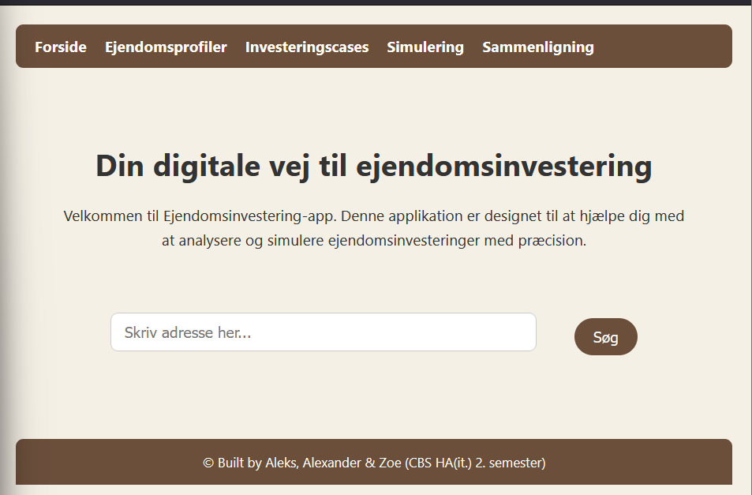
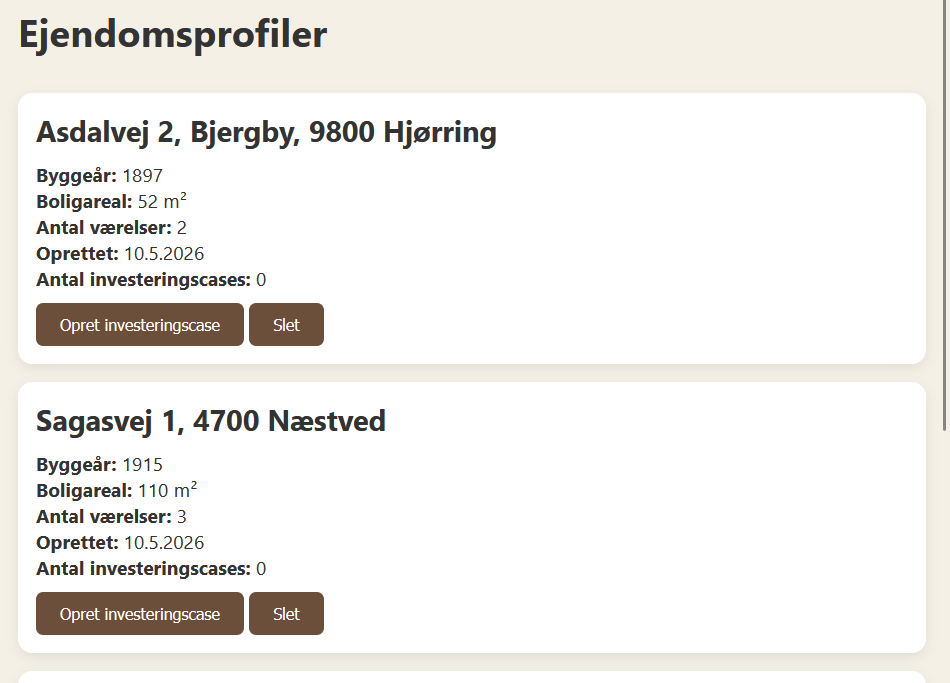
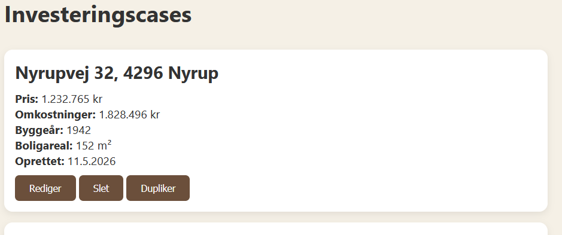
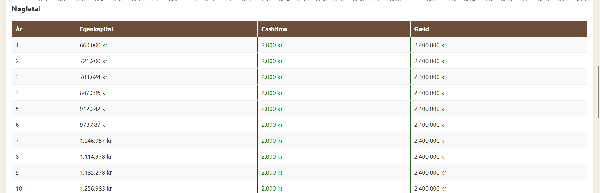
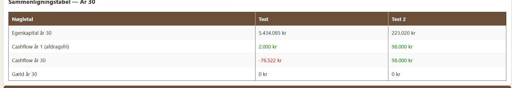

Ejendomsinvesterings app:

Produktet er en webapplikation udviklet til at søge boligere og derefter at analysere og simulere ejendomsinvesteringer.

Om projektet:

Denne applikation guider brugeren med at søg ejendom, analysere den, simulere investeringscase og sammenligne forskellige cases.
Formålet er at give brugeren en datadrevet måde at investerer i ejendomme.

Features:

Input felt hvor brugeren kan søg efter en adresse

Ejendomsprofiler, som gemmer oplysninger om boligen

Investeringscases, som gemmer oplysninger om investeringen

Simulering af relevante nøgletal for investeringen

Sammenligning af forskellige investeringer

Teknologier:

Vi bruger HTML, CSS, JavaScript og Azure SQL database

Installation:

Installer node.js

Installer npm - npm install

Start serveren - node app.js

Går ind på linket - http://localhost:8000/

Brug af hjemmesiden:

Header:
I toppen af hver side kan du se headeren, som bruges til at navigere mellem de forskellige sider, fx forside, investeringscases eller sammenligning.

Forsiden:
I midten af forsiden er der en inputfelt hvor du skriver den adresser du gerne vil søg.
Derefter trykker du på søg.

Ejendomprofil:
Du bliver automatisk sendt til en anden side, hvor du kan se oplysninger om den søgte bolig, bl.a. boligtype, byggeår og antal værelser.
Der er også 2 knapper, en til at gemme ejendomsprofilen, så den kan ses igen senere, og en knap til at oprette investeringscase for boligen.
Efter du har trykket på gem ejendomsprofil, kan du enten opret investeringscase med det samme, eller brug headeren til at se dine gemte ejendomsprofiler. Du kan også gå tilbage til forside og søg en anden bolig. 

Ejendomsprofiler:
Hvis du trykker på ejendomsprofiler i headeren, kan du se alle dine gemte boligere.
Du kan enten slette dem fra databasen eller oprette investeringscase.
Hvis du trykker på opret investeringscase, bliver du sendt til en anden side hvor du indtaster oplysninger om casen.

Investeringscase:
Der er i alt 5 sider, hvor du bliver guidet i hvilke oplysninger du skal skrive i de forskellige input felter.
Til sidst skal du trykke på gem investeringscase, så den gemmes til senere.

Investeringscases/case oversigt:
Du kan trykke på investeringscases i headeren for at se alle dine gemte.
Der får du lov til at rediger, slet eller dupliker dem.
Hvis du vælger rediger, så bliver du sendt tilbage hvor du kan rette i de oplysninger du har lyst til.

Simulering:
Efter du har oprettet mindst en investeringscase, kan du trykke på simulering i headeren.
Der kan du vælge hvilken case du vil bruge til simuleringen og hvad simuleringsperioden skal være. (30år som udgangspunkt)
Derefter trykker du på kør simulering.
Så bliver der oprettet en graf der visualiserer udviklingen af egenkapitalen, cashflow og gæld over den valgte periode.
Der er også en tabel som viser samme oplysninger, men bare som tal.

Sammenligning:
Hvis du har mindst 2 forskellige investeringscases, kan du nu trykke på sammenligning i headeren.
Der kan du vælge de to investeringscases du har lyst til at sammenligne og simuleringsperioden. 
Derefter skal du trykke på sammenlign.
Der oprettes 3 grafer der viser sammenligninen for boligerne i egenkapital, cashflow og gæld.
Nedeunder kan du også se en tabel med nøgletal over sammenlignignen. 

Udviklere af projektet:
Aleks Ilieva
Alexander Mirchev
Zoe Berantzino